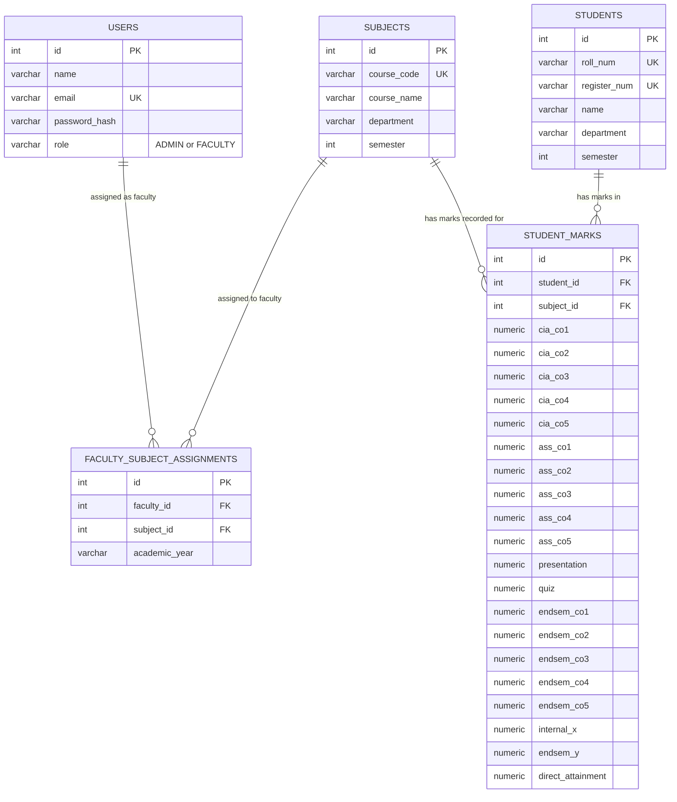
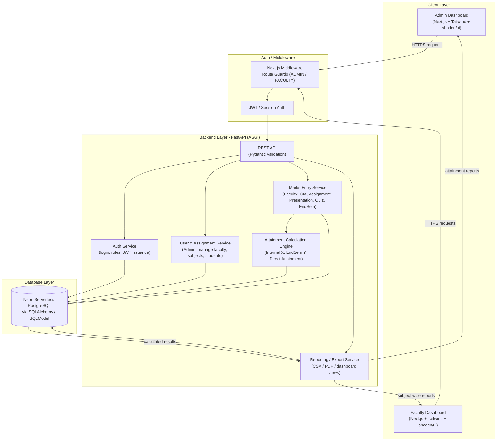

# Student Mark Attainment System

A centralized, web-based student mark database system that helps college faculties enter, calculate, and retrieve student marks — automating Course Outcome (CO) attainment calculations and replacing manual spreadsheet workflows.

## Tech Stack

- **Backend:** Python (FastAPI) — ASGI support, automatic Pydantic validation
- **Database:** Neon (Serverless PostgreSQL) via SQLAlchemy / SQLModel
- **Frontend:** Next.js + Tailwind CSS + shadcn/ui

---

## ER Diagram



---

## System Architecture



---

## Folder Structure

```
student-mark-attainment-system/
│
├── backend/                          # FastAPI service
│   ├── app/
│   │   ├── main.py                   # FastAPI app entrypoint, router registration
│   │   ├── config.py                 # env vars, settings (DB URL, JWT secret, etc.)
│   │   ├── database.py               # SQLAlchemy/SQLModel engine + session
│   │   │
│   │   ├── models/                   # SQLModel/SQLAlchemy ORM models
│   │   │   ├── user.py
│   │   │   ├── subject.py
│   │   │   ├── student.py
│   │   │   ├── faculty_subject_assignment.py
│   │   │   └── student_marks.py
│   │   │
│   │   ├── schemas/                  # Pydantic request/response schemas
│   │   │   ├── user.py
│   │   │   ├── subject.py
│   │   │   ├── student.py
│   │   │   └── marks.py
│   │   │
│   │   ├── routers/                  # API route handlers, grouped by resource
│   │   │   ├── auth.py               # login, token refresh
│   │   │   ├── users.py              # admin: manage faculty accounts
│   │   │   ├── subjects.py           # admin: manage subjects
│   │   │   ├── students.py           # admin: manage students
│   │   │   ├── assignments.py        # admin: assign faculty to subjects
│   │   │   ├── marks.py              # faculty: enter/edit marks
│   │   │   └── reports.py            # both: attainment reports, exports
│   │   │
│   │   ├── services/                 # business logic, kept out of routers
│   │   │   ├── auth_service.py       # JWT issuance, password hashing
│   │   │   ├── calculation_service.py # Internal X, EndSem Y, Direct Attainment
│   │   │   └── report_service.py     # CSV/PDF export logic
│   │   │
│   │   ├── core/
│   │   │   ├── security.py           # JWT decode, password hashing helpers
│   │   │   └── permissions.py        # role-based access control (ADMIN/FACULTY)
│   │   │
│   │   └── deps.py                   # shared FastAPI dependencies (get_db, get_current_user)
│   │
│   ├── alembic/                      # DB migrations
│   │   ├── versions/
│   │   └── env.py
│   │
│   ├── tests/
│   │   ├── test_auth.py
│   │   ├── test_marks.py
│   │   └── test_calculation_service.py
│   │
│   ├── requirements.txt
│   ├── alembic.ini
│   └── .env
│
├── frontend/                         # Next.js app
│   ├── app/
│   │   ├── (auth)/
│   │   │   └── login/page.tsx
│   │   │
│   │   ├── (admin)/
│   │   │   ├── dashboard/page.tsx
│   │   │   ├── faculty/page.tsx      # manage faculty
│   │   │   ├── subjects/page.tsx     # manage subjects
│   │   │   ├── students/page.tsx     # manage students
│   │   │   ├── assignments/page.tsx  # assign faculty to subjects
│   │   │   └── reports/page.tsx      # department-wide attainment reports
│   │   │
│   │   ├── (faculty)/
│   │   │   ├── dashboard/page.tsx
│   │   │   ├── subjects/[id]/marks/page.tsx  # mark entry grid
│   │   │   └── reports/page.tsx      # subject-wise attainment report
│   │   │
│   │   ├── layout.tsx
│   │   └── middleware.ts             # route guards by role
│   │
│   ├── components/
│   │   ├── ui/                       # shadcn/ui primitives (button, table, dialog...)
│   │   ├── marks/
│   │   │   ├── MarksEntryTable.tsx
│   │   │   └── MarksEntryForm.tsx
│   │   ├── reports/
│   │   │   ├── AttainmentChart.tsx
│   │   │   └── AttainmentTable.tsx
│   │   └── shared/
│   │       ├── Navbar.tsx
│   │       └── RoleGuard.tsx
│   │
│   ├── lib/
│   │   ├── api.ts                    # fetch wrapper / axios instance
│   │   ├── auth.ts                   # token storage, session helpers
│   │   └── calculations.ts           # client-side preview calc (optional, mirrors backend)
│   │
│   ├── types/
│   │   ├── user.ts
│   │   ├── subject.ts
│   │   ├── student.ts
│   │   └── marks.ts
│   │
│   ├── public/
│   ├── tailwind.config.ts
│   ├── next.config.js
│   ├── package.json
│   └── .env.local
│
├── docs/
│   ├── er-diagram.mermaid
│   └── architecture.mermaid
│
└── README.md
```
